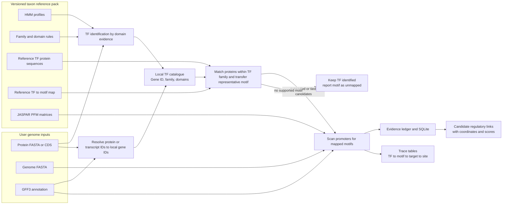

# ReguTrace

**Local, offline TF–target evidence backend.** ReguTrace builds candidate
TF–target relationships from genome/GFF/promoter sequences and PWM motifs, then
merges predictions with user-provided evidence (DAP-seq, ChIP-seq, EMSA,
reporter, curated lists) into one evidence ledger with explicit provenance.

ReguTrace is not a binding predictor and does not claim causality. Every row is
annotated with an evidence level and source; low-confidence predictions stay
separate from experimental evidence.

## Status

ReguTrace is a local pipeline for identifying TF genes, mapping supported TFs
to reference DNA-binding motifs, scanning promoters, and keeping every result
with its provenance. It is integrated into the rsWGCNA dashboard as the
`/toolkits/regutrace` toolkit.

The default plant workflow uses PlantTFHunter family rules and same-family
reciprocal protein best hits to transfer a representative JASPAR 2024 motif
before scanning local promoters. The plant reference contains 615 protein
donors covering multiple species. The dashboard accepts a genome, GFF3, CDS
or protein FASTA, and a gene annotation table. Other reference packs provide
taxon-specific rules for budding yeast, nematodes, and Drosophila.

See [NEWS](NEWS.md) for changes and HF1 coverage.

## Technical roadmap

The pipeline separates protein-based TF identification from DNA-based target
candidate prediction. The two steps are connected by a reference-motif mapping
stage; each prediction remains traceable to the local TF gene, reference donor,
motif, promoter, and site.



### What each stage means

1. **Identify TFs:** HMMER searches the supplied proteins for conserved
   DNA-binding domains. Taxon-specific rules use domain types, copy counts,
   auxiliary domains, and exclusions to classify families. This stage does
   not use promoter motifs.
2. **Resolve gene identity:** GFF3 relationships or an explicit ID map connect
   protein/transcript records to the user's local gene IDs. A reference donor
   name is not substituted for the local gene ID.
3. **Map a motif:** local TF DNA-binding domains are compared with reference TF
   donors that have a motif matrix. Supported ties remain multiple candidates;
   unsupported mappings stay unmapped rather than being forced.
4. **Scan targets:** mapped PFM matrices are searched against promoters
   extracted from the user's genome and GFF3. The result is a computational
   binding-site candidate (evidence level D), not proof of in-vivo binding or
   regulation.
5. **Keep the evidence chain:** `tf_genes.tsv`, `tf_map.tsv`, trace tables,
   `evidence.tsv`, and `evidence.db` let users inspect the TF gene, mapping,
   motif, target promoter, site coordinates, score, and p-value.

### Scope and interpretation

- A plant, animal, or fungal label alone is not enough to identify every TF.
  Automatic identification requires the matching HMM models and family rules
  supplied by a reference pack.
- The installed beta packs cover plants, yeast, nematodes, and *Drosophila*;
  other kingdoms and taxa do not automatically inherit those rules.
- The dashboard defaults to reference-pack mode. Manual motif-only scan is an
  advanced custom scan, cannot identify TF genes by itself, and is marked as
  motif-only rather than a WGCNA prior.
- A manual motif-only scan can report motif hits, but cannot claim that a hit
  belongs to a local TF gene unless a valid TF-to-motif map is supplied.
- A motif hit is a candidate binding site. ChIP/DAP-seq, expression, chromatin
  accessibility, and perturbation evidence are separate evidence sources.

## Evidence levels

| level | meaning | examples |
|---|---|---|
| A | point-to-point validation | EMSA, reporter, ChIP-qPCR, mutant |
| B | broad in vivo binding | ChIP-seq, ChIP-chip |
| C | broad in vitro binding | DAP-seq, PBM, SELEX |
| D | computational prediction | promoter PWM / motif |
| E | functional/associative evidence | perturbation, co-expression |

DAP-seq is in vitro; ChIP-seq is in vivo. Do not conflate them.

## Build

```bash
cargo build --release
```

Output: `target/release/regutrace` (`.exe` on Windows).

## Quick start

Fetch a minimal Arabidopsis data pack (genome/GFF/protein + JASPAR plant PFMs):

```bash
bash scripts/fetch-data.sh
```

Scan promoters (1 kb upstream) with an optional TF→motif map:

```bash
regutrace scan \
  --genome data/Arabidopsis_thaliana.TAIR10.dna.toplevel.fa.gz \
  --gff data/Arabidopsis_thaliana.TAIR10.60.gff3.gz \
  --motifs data/JASPAR2024_CORE_plants_non-redundant_pfms_jaspar.txt \
  --tf-map tf_map.tsv \
  --promoter-len 1000 --pvalue 1e-4 \
  --out evidence.tsv
```

Store and query evidence:

```bash
regutrace import --db reguledger.db --evidence evidence.tsv
regutrace stats  --db reguledger.db
regutrace export --db reguledger.db --out evidence_export.tsv
```

Export the full hit table to SQLite, CSV/TSV, gzip or JSONL:

```bash
regutrace convert --input evidence.tsv --out evidence.db --format sqlite
regutrace convert --input evidence.tsv --out evidence.csv.gz --format csv --gzip true
regutrace convert --input evidence.tsv --out evidence.jsonl.gz --format jsonl --gzip
```

Validate a canonical prior database and query upstream TFs for a module gene list:

```bash
regutrace validate-db --db evidence.db
regutrace prior --db evidence.db --targets module_genes.txt --out upstream.tsv
```

### One-command pipeline with a reference pack

A versioned reference pack supplies the HMM library, family rules, reference
protein sequences and donor map, and JASPAR matrices. The plant workflow
accepts genome FASTA, GFF3, protein or CDS FASTA, and a normalized annotation
TSV with `gene_id` and `symbol` columns. The dashboard also accepts raw eggNOG
and annotation tables and normalizes them before running the CLI.

```bash
regutrace pipeline \
  --reference-pack reference-packs/plant-jaspar-2024-rbh \
  --genome genome.fa.gz \
  --gff annotation.gff3.gz \
  --proteins proteins.faa \
  --annotation gene-annotation.tsv \
  --out-dir run/plant \
  --hmmsearch /path/to/hmmsearch \
  --blastp /path/to/blastp \
  --threads 4
```

Outputs in `run/plant/`: `tf_genes.tsv`, `tf_map.tsv`, `evidence.tsv`,
`evidence.db`, `promoters.fa`, `progress.json`, `scan-report.json`,
`pipeline-report.json`, and three small derived trace tables:
`tf_motif_trace.tsv`, `motif_ambiguity.tsv` and `target_candidate_ties.tsv`. `evidence.db` uses the `hits`/`pairs` schema
expected by `validate-db` and `prior`. The pipeline report lists the TF
catalogue (including ambiguous/rejected counts), mapped/fallback counts,
retained/excluded rows, `scanned_without_hits` (actually scanned motifs with no
hit), and `excluded_fallback_motifs` (mappings excluded before scanning). Target
IDs follow the GFF gene IDs; NCBI RefSeq keeps the `gene-` prefix, so use those
IDs for `prior` queries. `motifs.threshold` reports the minimum achievable
p-value for every motif in the pack; if a request is below that bound for an
actually scanned motif, the report and console warn, but the scan continues
with the user-supplied threshold. `scan.gene_biotype` records whether a
requested biotype filter was requested, whether it came from the user or pack
default, and whether it was actually applied or skipped.

### Traceability from TF to motif to target to site

The three trace tables are the normal lookup path; `evidence.tsv` remains the
site-level table and is not duplicated.

- `tf_motif_trace.tsv` — one row per local TF–motif pair: TF identification
  status/source, motif name/library, reference TF donor, mapping method,
  domain mode, scan status, ambiguity counts, evidence summary and one example
  target/site.
- `motif_ambiguity.tsv` — motifs shared by more than one local TF, or mapped
  through multiple/tied reference donors; it lists all candidates instead of
  collapsing them.
- `target_candidate_ties.tsv` — sites where the same target/motif/promoter
  window/hit is supported by more than one TF candidate.

To follow one candidate:

1. `tf_genes.tsv` — the local TF and its identification status.
2. `tf_motif_trace.tsv` — filter `tf_id`/`tf_symbol`; read the motif ID/name,
   `reference_donors`, `mapping_methods`, `mapping_ambiguous`, `scan_status`,
   and `shared_motif_tfs`. `reference_donors` is a JSON array with one
   `tf_id`/`tf_symbol`/`tf_family` record per reference donor; the semicolon
   columns are summaries only.
3. `evidence.tsv` — filter the same `tf_id` + `motif_id`; every row gives a
   target gene and a `promoter_start/end` + `hit_start`/`hit_end`/`strand` site.
4. `target_candidate_ties.tsv` — filter target + motif + promoter window + hit
   coordinates to see all TF candidates tied at that site. The promoter window
   is part of the key, so identical relative hits in two windows are separate
   genomic sites.

`mapping_ambiguous=true` means the local TF–motif pair has more than one
mapping row (for example, multiple reference donors) or a tied reciprocal DBD
hit. `shared_motif_tf_count>1`
means multiple local TFs use the same motif; the site table keeps all of them
as separate candidates. These are candidate ambiguities, not co-binding or
validated targets. See [docs/TRACE.md](docs/TRACE.md) for column definitions
and a worked example.

The reference pack is checked against `manifest.json` SHA-256 values. Its
`manifest.json` names the required relative files (`hmm`, `rules`,
`reference_map`, `reference_domains`, `dbd_models`, `motifs`) and optional
tool names. The plant beta validation pack (`plant-beta-2026-11-15`,
distributed with the validation analysis) identifies all PlantTFDB families and
transfers motifs for MYB only; see the validation report for the exact scope.
The nematode beta pack (`nematode-beta-2026-11-15-r2`) adds AnimalTFDB-family
identification and C. elegans-only JASPAR motif transfer, with
`protein_coding` as its default target biotype. The earlier
`nematode-beta-2026-11-15` is retained for audit but should not be used for new
runs. The Drosophila beta pack (`drosophila-beta-2026-11-15`) uses the same
animal rules/HMMs with JASPAR insect motifs; its known-target validation uses
Hsf/MA1458.2. Use `--include-single-domain-fallback` to scan mappings
marked `single_domain_fallback`; default scan behavior is full-architecture only.
`--promoter-len`, `--downstream` and `--pvalue` override the pack defaults.
`--gene-biotype <value>` limits scanning to GFF `gene_biotype` features; a pack
can set this default in `manifest.defaults.gene_biotype`. This is important for
annotations such as RefSeq C. elegans, where the raw GFF produces many inferred
ncRNA/exon-only models in addition to protein-coding genes. If a pack default is
present but the GFF has no `gene_biotype` (for example a CDS-only custom
annotation), the default is skipped with a `GENE_BIOTYPE_FILTER_SKIPPED`
warning and all genes are scanned. An explicit user `--gene-biotype` on such a
GFF is a hard error with an actionable message.
Use `--cds` instead of `--proteins` for oriented CDS FASTA. NCBI-style
`[protein_id=...]` headers are used as record IDs for GFF mapping; records
that cannot be translated (partial/pseudogene) are skipped with a warning.
When CDS records have no `protein_id` (for example HF1), each `Parent`
transcript ID is used as the protein FASTA record ID and resolved through the
`mRNA`/`transcript` parent to its gene. Motif IDs must be unique; duplicate IDs
in a JASPAR-style library are rejected before scanning, so the scan and the
report always refer to the same matrix.

### Plant TF catalogue with HMMER and family rules

```bash
regutrace identify-plant-tfs --proteins representative.faa.gz \
  --hmm-list models.txt --rules plant-rules.json --gene-ids \
  --hmmsearch /path/to/hmmsearch --threads 4 --out tf_genes.tsv
```

Supply HMMER, the matching HMM libraries and a versioned JSON rule pack.
Use `--hmm` for one library or `--hmm-list` for a text file with one library
path per line. Relative entries in that list resolve next to the list.
Without `--hmmsearch`, the CLI finds it on PATH.

Use `--gene-ids` if each FASTA record's first header field is already a
unique gene ID. For protein or transcript accessions, use `--gff` with a
GFF3 containing `gene` plus `mRNA`/`transcript` and `CDS` features; ReguTrace
builds the protein-to-gene map from `protein_id`, `Parent`, and `locus_tag`
automatically. A separate `--gene-map` TSV (`protein_id`, `gene_id`) is still
accepted for unusual annotations. Each input record must have a mapping.
Multiple proteins may map to the same gene.
The output has one row per classified gene, with the rule pack version,
protein IDs, family assignments, and domain coordinates and scores.
Multiple distinct subfamilies are marked `ambiguous` for review.

For the lowest-friction workflow, users supply only genome FASTA, GFF3 and
protein FASTA (or CDS); HMM libraries, rule packs and reference TF-motif
resources are software-side reference data, not user uploads.

The rule pack specifies `version`, `domains` (model NAME to minimum domain
bit score), `fallback_evalue`, and `groups` of ordered rules. A null domain
score uses the full-protein E-value threshold. Each rule specifies
`family`, `subfamily`, and diagnostic domain conditions in `required`
(minimum counts), `any` (at least one from a list), or `maximum` (zero
excludes a domain). `only_listed_domains` optionally limits accepted
domains to the rule's positive conditions. The first matching rule per
group is used by default. An optional `domain_evalues` map supplies per-model
full-sequence E-value cutoffs; with `best_match: true`, the single matching
rule with the smallest supporting E-value wins across groups (used by the
AnimalTFDB nematode pack). The CLI runs independently of R and motif data.

Identify candidate TFs from one representative protein per gene and a HMMER3
profile library, then use the resulting catalogue as a scan gate:

```bash
regutrace identify-tfs \
  --proteins representative_genes.faa \
  --hmm plant_tf.hmm \
  --family-map hmm_to_family.tsv \
  --evalue 1e-5 --min-coverage 0.5 \
  --out tf_genes.tsv

regutrace scan \
  --genome genome.fa.gz --gff annotation.gff3.gz --motifs jaspar_plants.txt \
  --tf-genes tf_genes.tsv --tf-map tf_map.tsv \
  --out evidence.tsv
```

`tf_genes.tsv` must contain `gene_id`; `tf_symbol`, `family` and
`identification_status` are optional. Only rows marked `identified` are
eligible. With `--tf-genes`, every `tf_map.tsv` `tf_id` must resolve to an
identified gene in the catalogue; otherwise the scan fails before searching.
Without `--tf-genes`, `--tf-map` remains the legacy motif-label mode.

`--tf-map` is optional when no TF catalogue is supplied. When it is omitted,
`tf_id`/`tf_symbol` are taken from the motif header name (for example JASPAR
`>MA1758.2 HSFA1E`); provide a tf-map when you need gene IDs or family
annotations.

If `tf_map.tsv` has a `domain_mode` column, `scan` and `validate` exclude
rows explicitly marked `single_domain_fallback` by default. Rows with an
empty or unknown `domain_mode` (including older maps without the column) are
kept. Use `--include-single-domain-fallback` to scan the fallback rows too.
Both commands print a `TFMAP_DOMAIN_FILTER` report with total/fallback/
retained/excluded counts; a map containing only fallback rows fails both
`validate` and `scan` with `TFMAP_ALL_FALLBACK_FILTERED` unless the flag is
supplied.

Add `--downstream 100` to include 100 bp past the TSS; PlantRegMap uses
TSS −500/+100, i.e. `--promoter-len 500 --downstream 100`.

Or scan a promoter FASTA directly (useful for benchmarks/other tools):

```bash
regutrace scan --promoters promoters.fa --motifs ... --tf-map ... --out evidence.tsv
```

## Input validation

Review genome/GFF/motif/TF-map inputs without scanning and get a
machine-readable report:

```bash
regutrace validate \
  --genome data/genome.fa --gff data/annotation.gff3 \
  --motifs data/jaspar.txt --tf-map tf_map.tsv \
  --report-json report.json
```

`scan` also accepts `--report-json`. Reports use stable codes, severities,
context and suggestions for frontends and RAG assistants; see
[docs/DIAGNOSTICS.md](docs/DIAGNOSTICS.md).

## Large scans, streaming and progress

A whole-genome scan with hundreds of motifs can emit millions of rows. Add
`--stream` to write the evidence TSV incrementally instead of retaining every
row in memory (rows are in scan order, not sorted), and `--progress-json` to
publish stage/progress for a frontend. Scanning is parallel by default, using
`CPU cores - 1` worker threads; set `--threads N` explicitly or `--threads 1`
for serial execution:

```bash
regutrace scan \
  --genome genome.fa --gff annotation.gff3 --motifs jaspar_plants.txt \
  --promoter-len 1000 --pvalue 1e-4 \
  --out evidence.tsv --stream --threads 8 \
  --progress-json progress.json --report-json report.json
```

`progress.json` is updated atomically with fields `stage`, `status`, `done`,
`total`, `progress` and `message`. Stages include `reading_motifs`,
`reading_genome`, `reading_gff`, `extracting_promoters`, `scanning`,
`writing_evidence`, `done` and `failed`. The dashboard toolkit consumes this
file, indexes the evidence TSV on disk by TF/target/motif, and keeps queries
interactive without loading millions of rows into memory.

On a Tartary buckwheat benchmark (2,000 promoters × 805 JASPAR motifs), 7
worker threads reduced the scan from 59 s to 17.2 s (about 3.4×) with identical
528,201 hits. The default is `available_parallelism() - 1`; use `--threads 1`
for the old serial behaviour.

## Evidence schema

Unified TSV columns:

```text
tf_id  tf_symbol  target_id  target_symbol  evidence_type  evidence_level
method  source  pmid  condition  promoter_start  promoter_end  motif_id
hit_start  hit_end  strand  score  p_value  notes
```

Coordinates are 1-based inclusive. `hit_start/hit_end` are relative to the
promoter oriented 5'→3' in the gene's direction. See
[docs/EVIDENCE.md](docs/EVIDENCE.md).

## Benchmark

`scripts/benchmark.R` compares ReguTrace with Biostrings::matchPWM at a matched
false-positive rate. Current synthetic result (1,200 promoters × HSFA1E motif):
comparable accuracy (AP 0.970 vs 0.970) and ~80× faster (0.05 s vs 4.19 s).
See [docs/BENCHMARK.md](docs/BENCHMARK.md).

## Repository layout

```text
crates/regutrace-core/   FASTA/GFF/promoter/PWM/scan/evidence/SQLite
crates/regutrace-cli/    `regutrace` CLI
scripts/                 data-pack fetch + benchmark
docs/                    plan, evidence schema, benchmark, API plan
```

## Representative transcript

Each gene uses one representative transcript: the longest spliced transcript
(sum of exon lengths; CDS + UTR lengths when exon features are absent; genomic
span as a last resort). Ties prefer the most upstream TSS; a gene without any
transcript feature falls back to its gene coordinates.

## Limitations

- PWM prediction has high false-positive rates; many plant TF families share
  degenerate motifs. Predictions are family-level candidates.
- Promoter definition (length, TSS, UTR, transcript choice) strongly affects
  results; coordinates are always reported.
- Without ATAC/ChIP, prediction cannot distinguish accessible from bound sites.
- In manual `scan` mode, a `tf-map` is optional; without it, the motif header
  supplies a label, not an identified local TF gene. Use `pipeline` with a
  suitable reference pack to identify local TF genes and infer supported
  TF-to-motif mappings.
- GFF support covers `gene` + `mRNA`/`transcript`, `mRNA` without an explicit
  gene, gene-only models, and CDS/exon-only fallbacks. Unusual feature layouts
  are reported by `validate` rather than failing silently.
- MIT licensed. Reference data licenses are documented by `fetch-data.sh`.

### CDS input and motif transfer

Use `--cds` in place of `--proteins` for oriented, spliced CDS FASTA.
Translation uses the standard nuclear code and preserves the first FASTA
header field. It strips a terminal stop, rejects internal stops and
incomplete codons, and translates ambiguous IUPAC codons as X.

`map-tf-motifs` consumes a local `--tf-genes` catalogue, a curated
`--reference-map` in tf-map TSV format, and `--forward` and `--reverse`
protein alignment tables in BLAST format
`6 qseqid sseqid bitscore pident length qlen slen evalue`.
Align the DNA-binding domains with local gene IDs as forward queries
and reference TF IDs as reverse queries. Include competing alignments
so tied top hits can be detected. The first implementation requires
a reciprocal top hit, matching family labels, at least 80%
identity and 80% alignment-length coverage in both directions, and
E-value at most 1e-5. These are initial filters for inferred mappings. Tied reciprocal top hits are retained as separate candidate rows labeled reciprocal_dbd_tied_candidate. Shared motifs can yield identical sites for multiple candidate TFs.

Write the inferred scan-ready mapping with `--out tf_map.tsv`.
The file includes the donor TF ID and mapping method. Keep the reference
motif matrices alongside this file for use with `scan --motifs`.

To generate the alignments automatically, provide `--proteins` or `--cds`
from the identification run, `--reference-domains` (FASTA keyed by reference
TF IDs) and `--dbd-models` (JSON mapping each supported catalogue subfamily
to a DNA-binding HMM model name or an ordered list, for example
`{"HSF":"PF00447"}`). The command reads coordinates from the catalogue
evidence, extracts local domains and runs BLASTP in both directions.
When a TF has more domains than the configured architecture (C2H2 arrays,
Myb repeats, two Zn_clus domains, HMG), the extractor falls back to the
best-scoring single domain instead of dropping the gene. Catalogue `family`
labels are matched per `;`-separated segment, so rows such as `Hap4;bZIP`
work without a separate primary-family file. The output labels each mapping
with `domain_mode` (`full_architecture` or `single_domain_fallback`),
`extraction_family`, `extraction_models`, and `domain_count`; filter on
`domain_mode` when only complete-architecture evidence is acceptable.
Multi-family extraction currently chooses the highest-scoring configured
family per gene, not one record per family. Scan output copies the same
fields into `notes.motif_mapping`; SQLite stores that JSON in `notes`, so
imported evidence can be filtered with
`notes LIKE '%"domain_mode":"full_architecture"%'`.
Specify `--blastp` for a custom executable path. Reference sequences may
include competitors without motifs. Complexes and independent per-domain alignment thresholds still
require a separate transfer policy.
