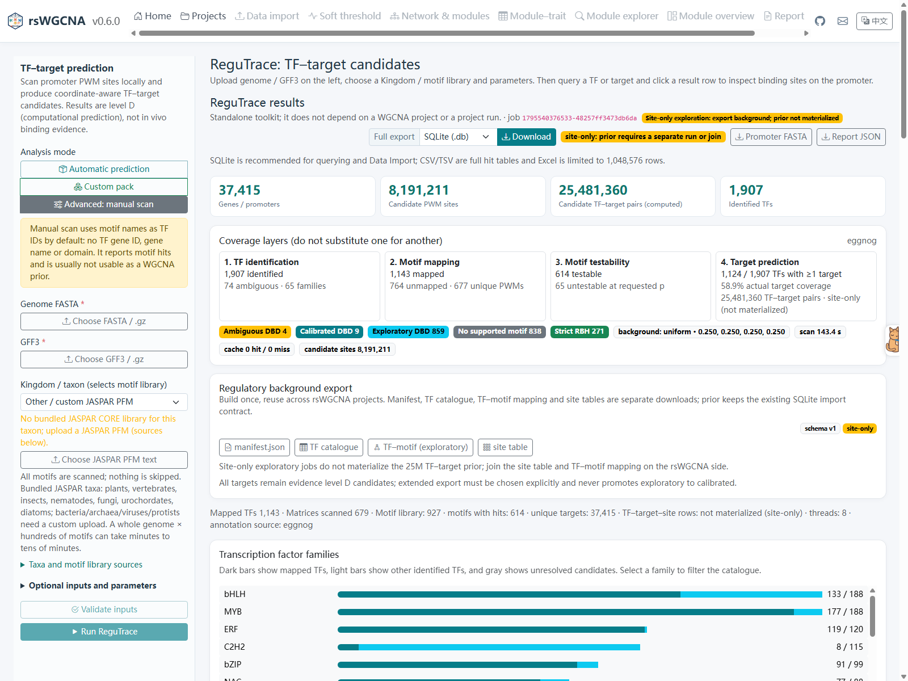
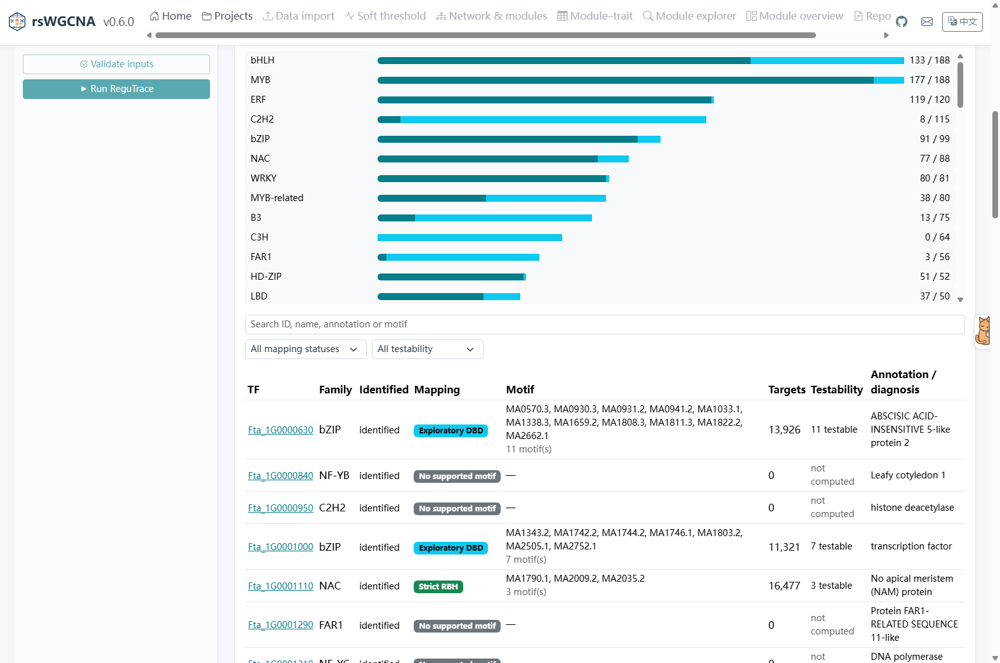
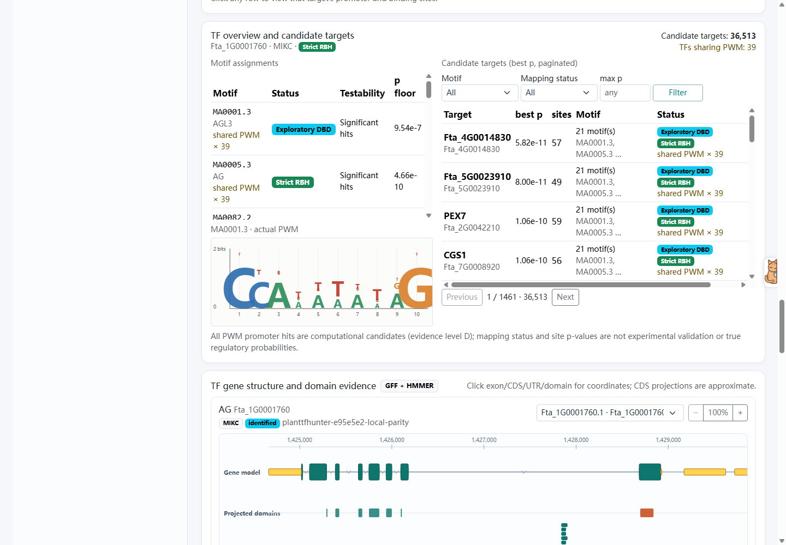
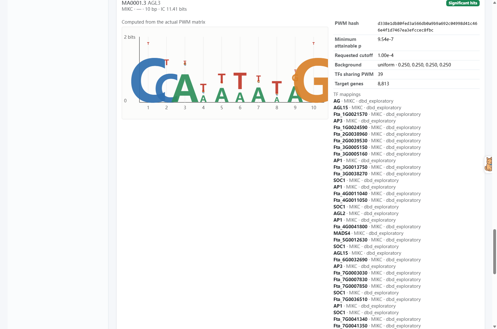
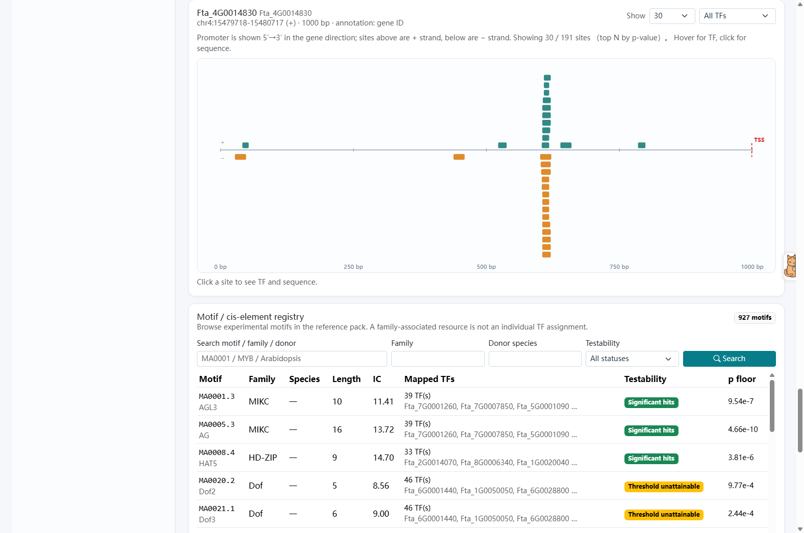
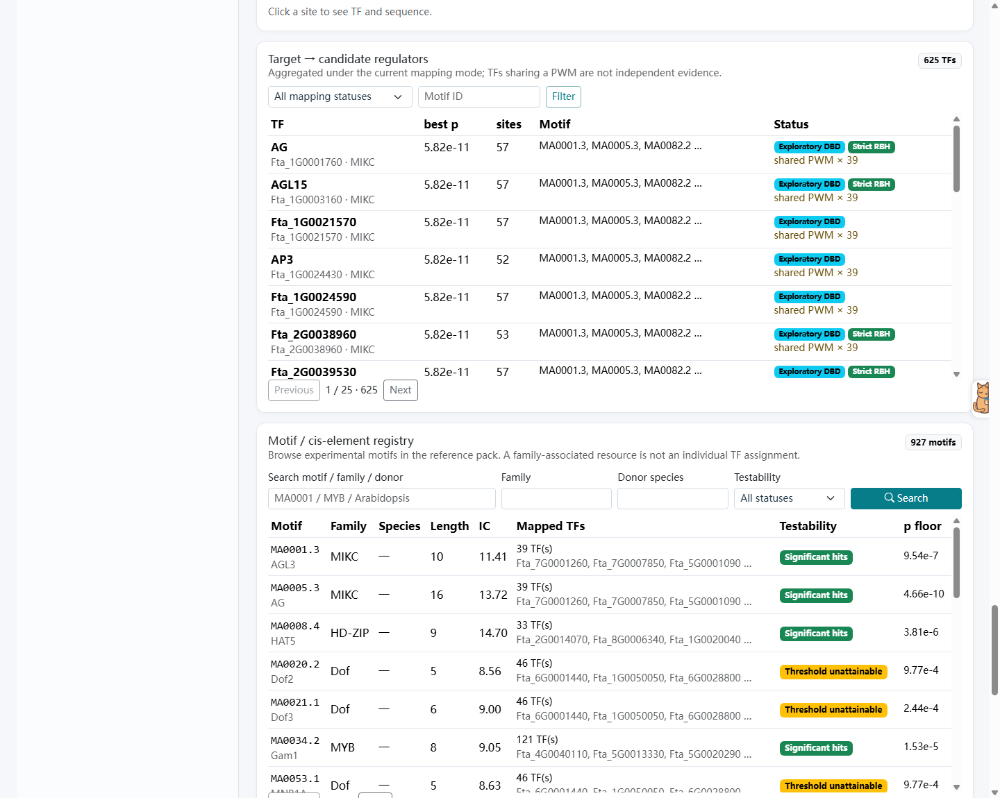
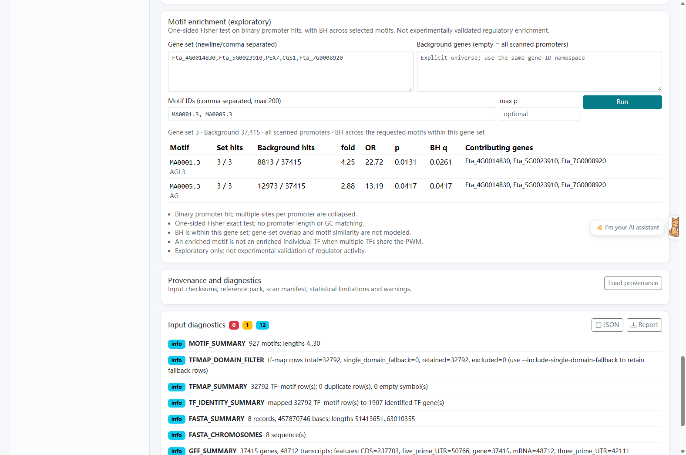
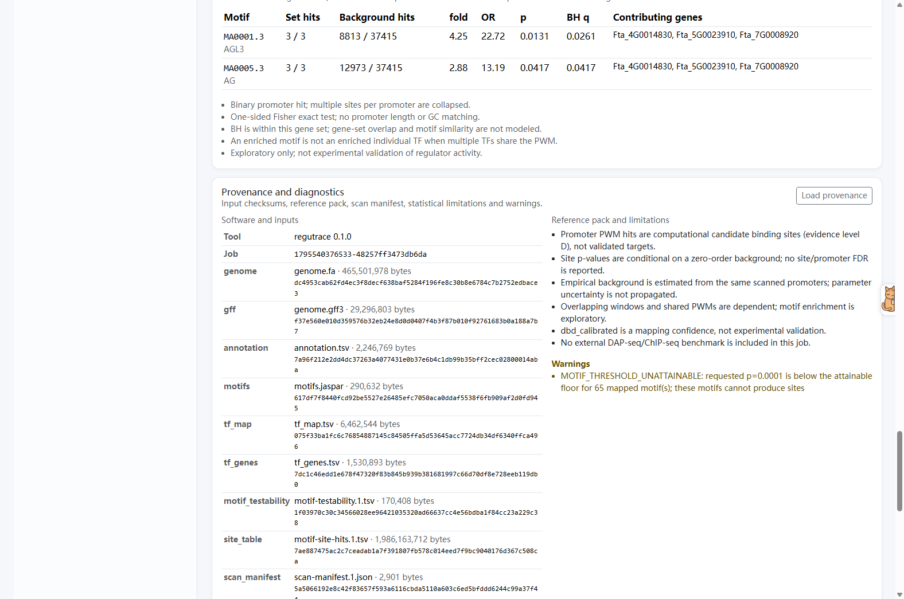

# ReguTrace Phase 4 — Dashboard, evidence exploration and user experience

**Date:** 2026-11-25
**Status:** implementation complete for the Phase 4 scope; Phase 5 not started.
**Scope:** standalone ReguTrace regulatory-background toolkit, integrated into the rsWGCNA dashboard as a toolkit page. No expression input is required by ReguTrace.

This report is the primary Phase 4 record. Supporting detail is in:

- [phase4-ui-audit.md](phase4-ui-audit.md)
- [phase4-query-architecture.md](phase4-query-architecture.md)
- [phase4-evidence-semantics.md](phase4-evidence-semantics.md)
- [phase4-performance.md](phase4-performance.md)
- [phase4-user-workflows.md](phase4-user-workflows.md)
- [phase4-decisions.md](phase4-decisions.md)
- [phase4-background-export.md](phase4-background-export.md)

Figures are in [`figures/phase4/`](figures/phase4/).

## 1. What Phase 4 added

### Backend (Go dashboard)

New read APIs over a completed ReguTrace run:

| Endpoint | Purpose |
|---|---|
| `GET /jobs/{id}` | Job summary, including TF catalogue and Phase 4 coverage fields |
| `GET /jobs/{id}/targets?tf=` | TF → candidate targets, paginated, sorted by best p |
| `GET /jobs/{id}/regulators?target=` | Target → candidate regulators, paginated |
| `GET /jobs/{id}/motifs` | Motif registry list with search/filter/testability |
| `GET /jobs/{id}/motifs/{motif}` | Motif detail: real PWM matrix, registry provenance, mapped TFs, target count |
| `POST /jobs/{id}/enrich` | Exploratory Fisher exact + BH across requested motifs |
| `GET /jobs/{id}/provenance` | Checksums, reference pack, scan manifest, warnings, limitations |
| `GET /jobs/{id}/export?kind=prior` | TF–target prior for rsWGCNA, policy-filtered |
| `GET /jobs/{id}/export?kind=tf_catalogue` | TF catalogue, including TFs with no motif/targets |
| `GET /jobs/{id}/export?kind=tf_motif` | TF–motif mapping with effective PWM hash and provenance |
| `GET /jobs/{id}/export?kind=manifest` | Regulatory-background manifest |
| `GET /jobs/{id}/export?kind=sites` | Optional site-level evidence attachment |

The existing endpoints (`query`, `promoter`, `tf`, `site`, evidence export, promoter FASTA) are unchanged in their contract.

### Site-only exploratory data path

Phase 3's `--sites-only` scan writes **one row per unique PWM site per PWM group**, not per TF. Phase 4 indexes that table on disk and joins TF–motif mappings at query time. This avoids materializing the exploratory TF × target × site cross-product (which would be hundreds of millions of rows) while still allowing TF → target and target → regulator exploration.

Implemented in:

- `crates/regutrace-cli/src/main.rs` — `--sites-only` requires `--sites-out`; no evidence rows are emitted.
- `crates/regutrace-cli/src/scan_phase3.rs` — skips the per-TF evidence loop in site-only mode; records `sites_only` in the scan manifest.
- `backend/internal/regutrace/site_dataset.go` — site-schema index, target/motif offset indexes, target bitsets, TF target counts.
- `backend/internal/regutrace/site_queries.go` — TF → target, target → regulator, promoter view, exact site evidence.
- `backend/internal/regutrace/phase4_views.go` — motif list/detail, TF targets, target regulators.

### UI (Vue 3)

All additions extend the existing ReguTrace toolkit page and use its existing Bootstrap visual language:

- analysis overview with coverage layers and mapping-status counts;
- TF catalogue filters for mapping status and testability;
- per-TF profile with mapping status, motif assignments, real PWM logo, paginated candidate targets, shared-PWM warning, diagnostic reason, and lazy protein sequence;
- motif/cis-element explorer with real PWM logos, registry provenance, testability, and mapped TFs;
- target promoter view with strand-aware site track, site sequence, and raw evidence rows;
- **target → candidate regulators** table (new bidirectional view);
- exploratory gene-set enrichment panel with explicit Fisher/BH caveats;
- diagnostics/provenance panel with checksums and limitations;
- prior and background export controls with policy selection.

Screenshots: `overview-final.png`, `catalogue-final.png`, `tf-profile-final.png`, `motif-detail-final.png`, `promoter-final.png`, `regulators-final.png`, `enrichment-final2.png`, `provenance-final.png`.

## 2. HF1 three-mode coverage

HF1: *Fagopyrum tataricum* (苦荞), 37,415 genes. Denominator below is the actual number of identified TF genes with a mapped identity in this run: **1,907**. The task book refers to 1,908 identified TFs; the pipeline's `TF_IDENTITY_SUMMARY` reports 1,907 after mapping the 32,792 TF–motif rows to gene IDs. The 1,908 figure was not reproduced and is not used to inflate coverage. One gene difference changes percentages by <0.01 percentage points.

All three modes reuse the **same** 8,191,211-site exploratory scan table and the mode-specific TF–motif maps. Strict and balanced counts are intersections with their maps; exploratory counts include all supported map rows. They are not three independent scans.

| Metric | Strict | Balanced | Exploratory |
|---|---:|---:|---:|
| Identified TFs (denominator) | 1,907 | 1,907 | 1,907 |
| TFs with candidate motif mapping | 271 | 280 | 1,143 |
| TFs with testable motif(s) | 242 | 251 | 1,124 |
| TFs with completed scanning | 242 | 251 | 1,124 |
| TFs with ≥1 candidate target | 242 | 251 | 1,124 |
| **Actual target coverage** | **12.69%** | **13.16%** | **58.94%** |
| TFs without supported motif | 1,636 | 1,627 | 764 |
| Ambiguous TFs | 0 | 0 | 11 |
| Unique effective PWMs | 268 | 280 | 677 |
| Motif–target associations | 1,942,819 | 2,106,719 | 4,644,497 |
| TF–target candidate associations | 1,960,433 | 2,144,797 | 25,481,360 |
| Median targets per TF | 4,587 | 4,893.5 | 21,715 |
| Target union | 37,413 | 37,413 | 37,415 |
| Incremental TFs vs previous mode | — | +9 (+0.47 pp) | +873 (+45.78 pp) |

Candidate-motif mapping coverage is 14.21% (strict), 14.68% (balanced), and 59.94% (exploratory); the difference between mapping coverage and actual target coverage is the testability/no-hit layer.

Shared run cost for all three modes: one site-only scan (135–144 s, 498 MB peak) over 8,191,211 sites; dashboard indexing and exploration peak at ~2.0 GB. Mode-specific background TF–motif table sizes: strict 44.8 kB, balanced 47.7 kB, exploratory 6.9 MB; the site table is 1.99 GB and the manifest 3,660 B.

Interpretation:

- Balanced adds only 9 TFs / +0.47 pp over strict on HF1. Calibrated DBD transfer is conservative.
- Exploratory reaches 58.94%, inside the expected 50–60% range, through sequence-supported DBD candidates. It is not calibrated and is not automatically promoted.
- 764 TFs still have no supported motif under exploratory; they are reported as `no_supported_motif`, not as zero-target successes.
- The exploratory row includes 11 ambiguous TFs that are excluded from target coverage by default in the UI and prior policies.

## 3. Evidence semantics

All PWM-derived target relations are **evidence level D** (computational candidate). The UI separates:

1. **TF identification coverage** — was a TF gene identified?
2. **Motif mapping coverage** — does it have a supported TF–motif mapping?
3. **Motif testability** — can the PWM reach the requested p-value under the background?
4. **Target prediction coverage** — does a mapped, testable motif produce at least one promoter hit?

Mapping status vocabulary:

- `strict_rbh` — existing full-length protein reciprocal best hit; semantics unchanged.
- `dbd_calibrated` — Phase 2.5 calibrated DBD transfer.
- `dbd_ambiguous` — DBD evidence does not resolve a specificity group; not used by default.
- `dbd_exploratory` — sequence-supported DBD candidate; not calibrated.
- `no_supported_motif` — identified TF without a supported mapping.
- `not_computed` — no mapping table was supplied.

Testability vocabulary:

- `significant_hits`, `no_significant_hits`, `threshold_unattainable`, `not_scanned`, `not_computed`.

The UI never labels a mapping confidence as target confidence, and never labels PWM hits as validated targets. Shared effective PWMs are shown as a warning because multiple TFs sharing one PWM are not independent evidence.

## 4. Bidirectional exploration

- **TF → targets:** `/targets` aggregates site hits per target, exposes best p, site count, motif IDs, mapping statuses, and shared-PWM count; deterministic sorting by best p, then target ID; pagination.
- **Target → regulators:** `/regulators` aggregates TFs for one target, with motif filter, mapping-status filter, max-p filter, and pagination.
- **Promoter view:** existing strand-aware track plus exact site evidence. The target panel links to it.
- **Motif explorer:** search by motif/family/donor, filter by testability, open detail with PWM matrix logo and registry provenance.

Large TF queries are served from a bounded per-job cache (4 entries) after the first aggregation. The first query for a 36,513-target TF takes ~6.3 s; subsequent pages take ~1–2 ms. See [phase4-performance.md](phase4-performance.md).

## 5. Configuration and background model

The UI exposes:

- promoter length and downstream window (legacy defaults preserved: 1,000 / 0);
- p-value cutoff (default `1e-4`);
- background mode: `uniform` (legacy default) or `empirical` (zero-order promoter A/C/G/T, with limitations displayed);
- threads;
- exact-PWM reuse;
- Phase 3 artifact output;
- scan cache;
- mapping mode (`strict` / `balanced` / `exploratory`);
- site-only exploratory mode;
- prior export policy.

No p-value is silently relaxed. If a motif cannot attain the cutoff, it is shown as `threshold_unattainable`; the UI does not lower the threshold to make it “work”.

## 6. Background export and rsWGCNA compatibility

See [phase4-background-export.md](phase4-background-export.md) for schemas. Summary:

- manifest (`regutrace-regulatory-background-v1`) with species/pack checksums, gene ID namespace, promoter definition, scan parameters, methods, table pointers, statistics, limitations;
- TF catalogue including TFs with no motif/targets;
- TF–motif mapping with effective PWM hash, donor, species, DBD metrics, calibration status, specificity groups;
- motif–target associations are queryable through the site table and motif views; they are not materialized as a second wide table;
- TF–target prior is available for non-site-only jobs via `/export?kind=prior&policy=strict|strict_calibrated|extended|selected`;
- site evidence remains an optional separate TSV.

For site-only exploratory jobs the TF–target cross-product is intentionally **not** materialized. The UI states this and offers the site table plus TF–motif mapping instead. Strict/balanced backgrounds can produce a prior.

Compatibility check: the prior export is converted with `regutrace convert` to the canonical SQLite schema with `hits` and `pairs` tables (`tf_id`, `target_id`, evidence columns; `pairs` grouped by TF–target). The dashboard Data Import path accepts a canonical `.db`. This is verified at the schema/import boundary; a full rsWGCNA network run using a Phase 4 prior was **not** performed in this phase.

## 7. Tests and verification

Actually run on 2026-11-25:

| Check | Result |
|---|---|
| Rust workspace tests (`cargo test --workspace`) | **124 passed** (46 CLI unit + 7 CLI integration + 2 Phase 3 + 69 core) |
| Python Phase 3 tests | **6 passed** |
| Go `internal/regutrace` | **46 passed** (including new Fisher/BH, mapping-status, site dataset/cache tests) |
| Go `internal/api` | **13 passed** (including Phase 4 endpoint integration) |
| `vue-tsc -b && vite build` | passed (2,227 kB bundle; chunk-size warning only) |
| HF1 exploratory site-only run | succeeded: 8,191,211 sites, 1,143 mapped TFs, 614 testable motifs, 4,644,497 motif–target pairs, 25,481,360 TF–target pairs |
| Coverage script cross-check | dashboard summary equals Python coverage exactly for motif–target pairs, TF–target pairs, target union |

Rust test note: the local w64devkit GCC 16 no longer ships a separate `libgcc_eh.a`; a local toolchain alias was needed for linking. This is an environment workaround, not a repository change.

No commit, push, merge, installer rebuild, or release was performed.

## 8. Performance summary

Full methodology and caveats: [phase4-performance.md](phase4-performance.md).

| Measurement | Result |
|---|---:|
| Site-only scan (8.19 M sites, 677 PWM groups, warm Phase 3 cache) | 135–144 s |
| Scanner peak working set | 498 MB |
| Server peak working set during indexing/heavy exploration | ~2.0 GB |
| Initial page DOMContentLoaded / load | 71 ms / 80 ms |
| Data-complete time (cold median TF) | ~3.3 s |
| TF target query, cold: 1,277 targets | 20 ms |
| TF target query, cold: 21,808 targets | 2.80 s |
| TF target query, cold: 36,513 targets | 6.26 s |
| TF target query, cached page | 1–2 ms |
| Target → regulators | 79 ms |
| Promoter view (191 sites) | 664 ms |
| Motif list (25) | 4 ms |
| Motif detail | 102 ms |
| Provenance (warm) | 2 ms |
| Enrichment (2 motifs) | 242 ms |
| Job summary payload | 1.08 MB |
| Background: TF catalogue | 317 kB |
| Background: TF–motif exploratory | 6.9 MB |
| Background: TF–motif balanced | 47.7 kB |
| Background: manifest (catalogue excluded) | 3,660 B |
| Site table | 1.99 GB |

The 1.08 MB job summary is dominated by the 1,981-row TF catalogue; it is a single load and paginated views take over afterwards. The largest remaining UX bottleneck is the first target aggregation for TFs with tens of thousands of targets (2.8–6.3 s), and the legacy free-query path (~4.2 s for a large TF). These are documented rather than hidden.

## 9. Known limitations and deferred work

- No external DAP-seq/ChIP-seq benchmark or non-reciprocal mapping evaluation was performed. That is Phase 5.
- Exploratory DBD mappings are not calibrated; no accuracy claim is made for the 58.94% coverage layer.
- The 11 ambiguous TFs are excluded by default; the UI exposes them but does not count them as covered.
- Site-only jobs cannot produce a materialized TF–target prior by design.
- The dashboard job registry is in memory: restarting the server loses job IDs even though artifacts remain on disk; the job must be rerun. This is an existing manager limitation, documented rather than changed in Phase 4.
- Background export is a set of separate downloads plus a manifest, not a single bundled archive. This is deliberate for the 2 GB site table.
- JASPAR 2024 remains the default; JASPAR 2026 remains a candidate, not a default.
- The empirical background is zero-order; no dinucleotide or composition-aware enrichment is implemented.
- Fisher/BH enrichment is exploratory: binary promoter hit, no GC/length matching, no gene-set overlap or motif-similarity correction.
- Full rsWGCNA network execution with a Phase 4 prior was not run.
- No frontend unit tests were added; verification is `vue-tsc`, production build, API integration, and browser screenshots.

## 10. Screenshots

Captured from the running dashboard with the HF1 exploratory job (1440 px wide).

## 11. Phase 5 boundary

Phase 5 should retain the deferred items: external dataset audits, DAP-seq/ChIP-seq benchmark, non-reciprocal and cascading mapping evaluation, FIMO comparison, dependence-aware statistics, composition-aware enrichment, and final JASPAR/background decisions. Phase 4 makes no claim that those are done.

**Stop point:** Phase 4 ends here. Phase 5 has not been started.
